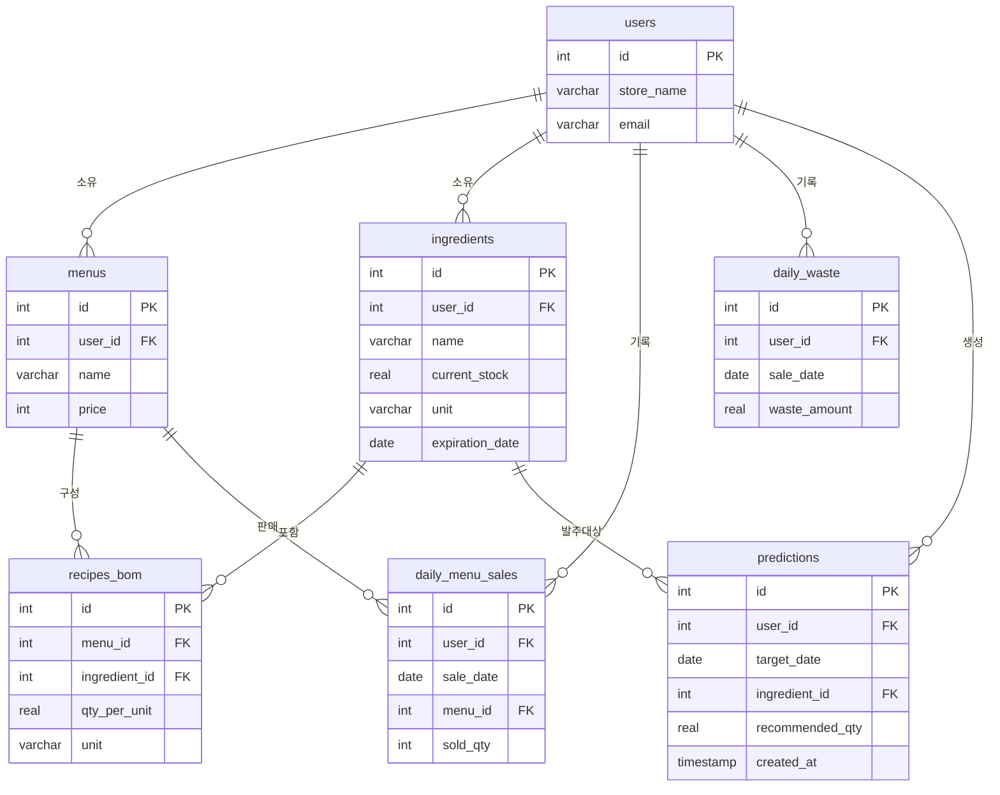

# ♻️ ZeroWaste F&B

> **중소형 F&B를 위한 식자재 수요 예측 & 폐기물 모니터링 웹 대시보드**
> 매일의 메뉴별 판매·폐기 데이터를 기반으로 내일의 식자재 발주량을 예측하고,
> 절감된 음식물 쓰레기를 탄소 감축 수치로 시각화합니다.

<p align="left">
  
  
  
  
  
  
</p>

---

## 📌 한눈에 보기

| 항목 | 내용 |
| :--- | :--- |
| **한 문장 정의** | 메뉴별 판매·폐기 데이터로 내일의 발주량을 예측하고, 절감된 음식물 쓰레기를 탄소 감축 수치로 시각화하는 중소형 F&B 전용 웹 대시보드 |
| **핵심 가치** | 글로벌 환경 문제(탄소 저감)를 소상공인의 실질적 비용 절감으로 치환 |
| **기술 스택** | React · Node.js(Express) · Python(Pandas) · PostgreSQL |
| **개발 기간** | 40일 (6주 마일스톤) |
| **성격** | 취업 포트폴리오용 풀스택 개인 프로젝트 |

---

## 🎯 문제 정의 (Why)

이 프로젝트는 개인적 흥미가 아니라, 확인 가능한 공신력 있는 지표에서 출발했습니다.

- **🌍 환경**: UNEP『Food Waste Index Report 2024』에 따르면 음식물의 손실·폐기는 전 세계 온실가스 배출량의 **8~10%**를 차지하며, 이는 항공산업 총배출의 약 5배 규모입니다.
- **🏪 시장(국내)**: KDI『나라경제』(2025.09)·국세청 통계 기준, 2024년 폐업 신고 사업자는 **100만 8,282명**으로 통계 집계 이래 처음 100만 명을 넘었고, **음식점업(15%)**이 폐업률 상위 업종입니다. 2023년 기준 소상공인 평균 영업이익률은 **5% 미만**입니다.
- **🧩 페인포인트**: 대기업은 AI로 식자재 폐기를 방어하지만, 자본력이 부족한 중소형 식당은 여전히 '사장님의 감'에 의존한 발주로 막대한 폐기 비용을 떠안습니다.

> **해결 가설**: 복잡한 딥러닝 없이도, 누적된 판매 데이터와 통계 기법(가중 이동 평균)만으로 직관 의존형 발주보다 정확한 수요 예측이 가능하며, 이를 직관적인 웹 대시보드로 제공해 접근성을 높일 수 있다.

---

## ✨ 핵심 기능

- **📝 영업 마감 데이터 입력** — 점주가 매일 '메뉴별 판매량'과 '폐기된 식자재량'을 웹에서 입력
- **🧠 자동 수요 예측** — 매일 자정, Python 배치가 최근 7~14일 데이터로 내일의 메뉴별 판매량을 예측
- **📦 식자재 발주 권장량 산출** — 예측 판매량 × 레시피(BOM) − 현재 재고 → 실제 발주 권장량 도출
- **📊 탄소 저감량 시각화** — 전월 대비 폐기물 감소량을 탄소 배출 감축(kg)으로 환산해 차트로 제공
- **⏰ 유통기한 임박 경고** — `expiration_date` 기준으로 임박 식자재를 붉은색으로 강조

---

## 🗺️ 사용자 플로우

```text
Step 1  영업 마감 데이터 입력 (웹)
          │
Step 2  자정 데이터 분석 및 수요 예측 (Python 배치)
          │
Step 3  익일 대시보드에서 발주 권장량 / 탄소 저감량 확인
```

---

## 🏗️ 시스템 아키텍처

```text
웹 대시보드 (React) — 데이터 입력 · 통계 차트 확인 · 발주 리스트 조회
│  REST API (JSON 통신)
▼
백엔드 API 서버 (Node.js + Express) — 데이터 CRUD · 클라이언트 요청 처리
              │
┌─────────────┴─────────────┐
▼                           ▼
DB (PostgreSQL)           데이터 분석/배치 (Python)
관계형 데이터 저장          자정마다 DB 조회 → 수요 예측 연산 → DB 업데이트
```

### 데이터 파이프라인 3단계

| 단계 | 흐름 | 설명 |
| :--- | :--- | :--- |
| **1. 수집** | React → Node.js → PostgreSQL | 점주 입력값을 검증 후 `daily_menu_sales`(판매)·`daily_waste`(폐기)에 적재 |
| **2. 예측** | Python Batch | 자정 실행, 최근 판매 데이터에 WMA 적용 → BOM 매핑 → 발주 권장량 산출 후 `predictions`에 저장 |
| **3. 시각화** | PostgreSQL → Node.js → React | 익일 대시보드에 발주 추천량·탄소 저감 차트·유통기한 경고 표시 |

> 🧮 **산출 예시**: "내일 아메리카노 80잔 예상" × "레시피(원두 20g/잔)" = 원두 1,600g 소요 → 현재 재고 차감 → 실제 발주 권장량 도출

---

## 🛠️ 기술 스택

| 파트 | 기술 / 라이브러리 | 버전 | 용도 |
| :--- | :--- | :--- | :--- |
| **Front-End** | React (JavaScript) | ^18.2.0 | 웹 대시보드 UI 및 컴포넌트 렌더링 |
| | react-router-dom | ^6.22.0 | 대시보드 내 페이지 라우팅 |
| | Recharts | ^2.12.0 | 폐기물 감소·탄소 저감량 시각화 |
| | Axios | ^1.6.0 | 백엔드 REST API 통신 |
| **Back-End** | Node.js (런타임) | ^20 LTS | 서버 사이드 JavaScript 실행 환경 |
| | Express (웹 프레임워크) | ^4.18.2 | RESTful API 라우팅·미들웨어 |
| **Database** | PostgreSQL (서버) | 18.x | 관계형 데이터베이스 서버 |
| | pg (Node.js 드라이버) | ^8.x | Node.js ↔ PostgreSQL 커넥션·쿼리 |
| **Data Pipeline** | Python (Pandas) | ^2.2.0 | 데이터 추출·수요 예측(WMA) 연산·적재 |
| | psycopg (Python 드라이버) | ^3.x | Python ↔ PostgreSQL 연결 |
| | schedule | ^1.2.1 | 자정 배치 스크립트 자동화 |

### 스택 선택 근거

- **Node.js + Express** — 백엔드의 주 역할이 클라이언트-DB 사이의 I/O 전달이므로, 비동기 I/O에 강한 Node.js가 적합. 라우팅·미들웨어는 경량 프레임워크 Express로 구성.
- **Python(Batch)** — 통계·행렬 연산 생태계(Pandas)가 우수하고, 예측 연산을 API 서버에서 분리해 메인 서버 병목을 방지.
- **PostgreSQL** — 판매 이력·레시피·재고처럼 개체 간 관계가 엄격한 정형 데이터라 데이터 무결성을 보장하는 RDBMS가 필수.
- **React** — 모바일까지 고려한 Flutter는 배제하고, 통계 차트·데이터 그리드 생태계가 넓은 React 웹 대시보드에 집중.

---

## 🗄️ 데이터베이스 설계 (ERD)

> **설계 원칙**: "메뉴별 판매량 → 레시피(BOM) 매핑 → 식자재 소요량 합산 → 발주 권장량 산출"이 데이터만으로 실제 계산 가능하도록 구성. 예측 입력(`daily_menu_sales`)과 탄소 저감 입력(`daily_waste`)의 역할을 분리.



| 테이블 | 역할 |
| :--- | :--- |
| `users` | 매장/점주 정보 |
| `menus` | 판매 메뉴 마스터 |
| `ingredients` | 식자재 마스터 + 현재 재고 + 유통기한 |
| `recipes_bom` | 레시피/BOM — 메뉴 1개당 필요한 식자재 구성 (메뉴↔식자재 N:M 연결) |
| `daily_menu_sales` | 일일 메뉴별 판매 기록 (수요 예측 입력) |
| `daily_waste` | 일일 폐기 기록 (탄소 저감량 산출 입력) |
| `predictions` | 파이썬이 계산한 내일 발주 권장량 |

---

## 📁 폴더 구조

```text
zero-waste-fnb/
├── frontend/                   # React 앱
│   ├── src/
│   │   ├── components/         # 재사용 UI 컴포넌트 (Card, AppBar 등)
│   │   ├── pages/              # 라우팅 페이지 (Login, Dashboard, Inventory)
│   │   ├── services/           # Axios API 호출 함수 (api_service.js)
│   │   ├── utils/              # 날짜 포맷·데이터 파싱 유틸
│   │   └── App.js              # 라우터 설정 및 진입점
│   └── package.json
│
├── backend/                    # Node.js API 서버
│   ├── src/
│   │   ├── controllers/        # 요청/응답 로직
│   │   ├── routes/             # API 엔드포인트 (/api/sales, /api/inventory)
│   │   ├── models/             # PostgreSQL 쿼리 및 DB 상호작용
│   │   └── config/             # DB 커넥션·환경변수 설정
│   └── server.js               # Express 진입점
│
└── pipeline/                   # Python 데이터 분석/배치
    ├── src/
    │   ├── data_loader.py      # 최근 14일 메뉴별 판매 데이터 Select
    │   ├── predictor.py        # Pandas WMA 예측 + BOM 매핑
    │   └── db_updater.py       # 발주 권장량을 predictions에 Insert
    └── run_batch.py            # Crontab/Schedule 구동용 메인 스크립트
```

---

## 🔌 주요 API (초안)

| 메서드 | 엔드포인트 | 설명 |
| :--- | :--- | :--- |
| `POST` | `/api/sales` | 오늘의 메뉴별 판매량·폐기량 저장 |
| `GET` | `/api/inventory` | 현재 식자재 재고 조회 (유통기한 포함) |
| `GET` | `/api/dashboard/summary` | 메인 차트용 통계 데이터 제공 |

---

## 🚀 시작하기

> ⚠️ 현재 **기획·설계 단계**입니다. 아래는 예정된 실행 절차이며, 구현이 진행되면 실제 명령어로 갱신합니다.

```bash
# 1) 저장소 클론
git clone https://github.com/<your-account>/zero-waste-fnb.git
cd zero-waste-fnb

# 2) 백엔드
cd backend
npm install
# .env 에 DB_URI 등 환경변수 설정 후
node server.js

# 3) 프론트엔드
cd ../frontend
npm install
npm start

# 4) 파이썬 파이프라인
cd ../pipeline
python -m venv venv && source venv/bin/activate   # Windows: venv\Scripts\activate
pip install -r requirements.txt
python run_batch.py
```

---

## 📅 개발 로드맵 (40일 · 6주)

- [ ] **1주차** — 기획·요구사항 확정, DB ERD 설계, 와이어프레임, API 명세서 작성
- [ ] **2주차** — Node.js(Express) + PostgreSQL 세팅, CRUD API 구현, 더미 데이터 적재
- [ ] **3주차** — Python 파이프라인 (DB 조회 → WMA 예측 → BOM 매핑 → 발주량 산출 → 자정 배치)
- [ ] **4주차** — React 뼈대 (라우터, 공용 컴포넌트, 입력 폼, 더미 상태)
- [ ] **5주차** — Front-Back 연동(Axios), Recharts 시각화, 유통기한 경고 UI
- [ ] **6주차** — 통합/E2E 테스트, 에러 핸들링, 문서화, 시연 영상

---

## 📚 참고문헌

1. UNEP. (2024). *Food Waste Index Report 2024: Think Eat Save — Tracking Progress to Halve Global Food Waste.* Nairobi.
2. KDI 한국개발연구원. (2025). 『나라경제』 2025년 9월호 — 자영업 폐업 분석(국세청 통계 기반).
3. 통계청 KOSIS 국가통계포털 — 서비스업조사·외식업체경영실태조사.

> 참고문헌 2·3은 제출 전 KOSIS 포털·원 발행처에서 구체 수치·발행연도를 최신화 예정.

---

## 👤 개발자

**사공민규** — 한국폴리텍II대학 인천캠퍼스 컴퓨터공학과(하이테크 과정)

풀스택 개인 프로젝트로, 문제 정의부터 데이터 설계·백엔드·데이터 파이프라인·프론트엔드까지 전 과정을 직접 설계·구현합니다.
