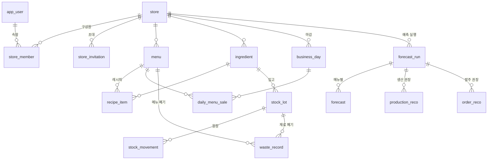

# 데이터 모델

> **무엇을 어디에 왜 저장하는지, 테이블 사이 관계, 매장 격리 · 재고 규칙을 적는 문서다.**
> 아직 마이그레이션이 없어서 지금은 이 문서가 원본이다. M2에서 Flyway 마이그레이션(`backend/src/main/resources/db/migration/`)이 생기면 **컬럼은 마이그레이션이 원본**이 되고, 여기에는 관계와 규칙만 남긴다. 왜 이렇게 정했는지는 [decisions/](decisions/README.md) 0008 · 0009.

## 1. 테이블 지도

| 묶음 | 테이블 | 하는 일 |
|---|---|---|
| 계정 · 매장 | `app_user` · `store` · `store_member`(점주 / 직원) · `store_invitation` | 한 사람이 여러 매장에 속할 수 있다. 매장은 위치(좌표 · 기상 격자 · 관측 지점 · 지역 코드)를 가진다 |
| 기준 정보 | `menu` · `ingredient` · `recipe_item` | 메뉴 = 고정 분류 + "당일 생산품" 표시 + 판매가. 식자재 = 기본 단위 + 탄소 분류 + 기본 단가(4절 9). 레시피 수량은 식자재의 기본 단위로만 |
| 마감 | `business_day` · `daily_menu_sale` | 하루 = 영업 / 휴무(휴무와 입력 누락을 구분한다). 메뉴 줄에 만든 · 판매 · 남은 수량, 품절 여부(+ 대략 시각), 남은 수량의 행방, **그날 판매가** |
| 재고 | `stock_lot` · `stock_movement` · `waste_record` · (실사) | 로트 = 입고 단위(유통기한 · **입고 단가**). 원장 = 추가만. 폐기 = 원인 · 대상(재료 또는 메뉴) |
| 예측 | `forecast_run` · `forecast` · `production_reco` · `order_reco` · `backtest_result` | 실행 단위로 저장(모델 버전 · 외부 신호 유무) |
| 공용 | `holiday` · `weather_observation` · `weather_forecast` · `carbon_factor` · `external_fetch_log` | 매장과 무관. 외부 원본은 `jsonb` |
| 세션 | Spring Session JDBC 테이블 | 재시작해도 로그인 유지 |

## 2. 관계도

컬럼은 넣지 않는다(마이그레이션이 원본). 공용 테이블은 매장과 이어지지 않아서 뺐다.

## 3. 매장 격리 (RLS)

앱이 매장으로 거르는 것이 첫 번째 벽, 복합 외래 키가 두 번째, RLS가 세 번째다. 사전 검증에서 찾은 함정이 규칙이 됐다.

1. **모든 매장 데이터에 `store_id`를 직접 둔다** — 레시피 줄처럼 부모를 거치면 알 수 있는 테이블도
2. **매장 데이터끼리는 `(store_id, id)` 복합 외래 키로 참조한다** → A 매장 마감에 B 매장 메뉴를 넣으면 DB가 거부한다
3. **현재 매장은 트랜잭션마다 넘긴다**: 트랜잭션 시작 때 `set_config('app.store_id', ?, true)`(= `SET LOCAL`). 커넥션 풀이 커넥션을 돌려 쓰므로 세션 단위로 걸면 남의 값이 남는다. 정책은 `store_id = current_setting('app.store_id', true)::bigint`
4. **값이 없으면 0건**이다(닫힌 쪽으로 실패). 설정을 빼먹은 코드는 아무것도 못 본다
5. **쓰기도 막는다**: 정책에 `WITH CHECK` — 남의 `store_id`로 INSERT · UPDATE 거부
6. **DB 역할을 나눈다**: Flyway = 테이블 소유자, 앱 = 앱 역할. 소유자 · 슈퍼유저는 RLS를 건너뛰므로 `FORCE ROW LEVEL SECURITY`도 건다
7. **테스트 함정**: Testcontainers 기본 계정은 슈퍼유저라 RLS가 안 걸린다 → 테스트도 앱 역할로 접속한다. 안 그러면 "테스트는 통과, 운영에서 무방비"
8. **RLS 없는 테이블**: `app_user`, 공용 데이터. `store_member` · `store_invitation`은 로그인 · 매장 고르기 전에 읽어야 해서 M2에서 따로 정한다
9. **배치는 매장마다** 트랜잭션 + `app.store_id`. 배치 전용 우회 역할은 없다
10. 인덱스는 `store_id`가 맨 앞

## 4. 마감 · 재고 규칙

| # | 규칙 | 이유 |
|---|---|---|
| 1 | 당일 생산품은 **만든 수량 · 남은 수량 · 품절 여부(+ 대략 시각)**를 받고, 판매 = 만든 − 남은. 음료처럼 주문 때 만드는 메뉴는 판매량만 | 품절 날은 판매량이 수요보다 작다(**검열된 수요**). 무시하면 예측이 계속 낮아지고 또 품절되는 악순환 |
| 2 | 남은 수량의 행방: **폐기 / 할인 판매 / 직원식 / 기부**, 기본값 폐기 | 기부 · 직원식은 낭비가 아니다 — 탄소 · 손실을 다르게 센다 |
| 3 | 재료는 **마감 입력 때 한 번에** 뺀다: 당일 생산품 = 만든 수량 × 레시피, 그 밖 = 판매량 × 레시피. 남은 빵의 재료는 만들 때 이미 썼으니 다시 안 뺀다 | 하루 단위 앱이라 충분하다 |
| 4 | 같은 날을 다시 입력하면 그날 마감을 **한 트랜잭션에서 통째로 바꾼다**. (매장, 날짜, 메뉴) UNIQUE | 두 번 쌓이지 않게. 🧩2 |
| 5 | 차감은 **유통기한 빠른 로트부터**(FEFO), 로트를 잠그고 뺀다 | 동시 입력에도 음수가 안 되게 |
| 6 | 원장은 **추가만** 한다. 틀리면 반대 줄을 더한다. 로트에 "남은 양"을 같이 두고 같은 트랜잭션에서 맞추며, "남은 양 = 원장 합계"를 테스트로 지킨다 | 언제 왜 바뀌었는지 전부 남긴다. 매번 합계를 내면 느리다 |
| 7 | 실사: 모자란 양은 유통기한 빠른 로트부터, 남는 양은 가장 최근 로트에 조정 줄로 | 자동 차감의 오차를 맞춘다 |
| 8 | 메뉴 폐기(남은 빵)의 탄소 · 원가는 레시피로 재료를 펼쳐 계산한다 | |
| 9 | 식자재 단가는 **로트 단가가 먼저, 없으면 식자재의 "기본 단가"**(점주가 넣는 값). M2에는 로트가 없어 기본 단가만 쓴다. 기본 단가가 빈 식자재는 원가 0이 아니라 "단가 없음"으로 두고, 손실 옆에 "단가 없는 재료 n개"를 띄운다 | 입고(F10)는 M3인데 M2 완료 기준이 "손실 원화"다(2026-11-09 사용자 결정). 0으로 세면 손실이 조용히 작아진다 |

## 5. 기술 규칙

- 수량 `NUMERIC`(Java `BigDecimal`), 돈은 원 단위 `bigint`, 영업일은 KST `DATE`, 시각은 `timestamptz`
- **기본 단가는 점주가 넣은 그대로 "가격(원) / 양(기본 단위)" 두 값으로** 둔다(밀가루 20,000원 / 20,000g). 1단위당 단가는 원 미만이 흔해서(버터 1g = 15원, 밀가루 1g = 1원, 달걀 1개 = 260원) 따로 저장하지 않고 계산하고, **원가 합계에서만 원으로 반올림**한다 — 2026-11-09 메뉴 · 레시피 시안에서 발견(사전 검증)
- 단위가 `개`인 식자재는 **1개 무게(g)**를 둔다 — 탄소 계수가 kg당이라서. 비어 있으면 그 재료는 탄소에서 제외. `ml`는 1ml = 1g으로 본다(우유 · 시럽 정도의 오차는 감수)
- 가격은 그때 값을 찍어 둔다: 마감 줄에 그날 판매가와 그날 원가(1개당, 레시피 × 그때 단가), 로트에 입고 단가 — 가격이 바뀌어도 지난 손실이 안 바뀐다
- 예측은 실행 단위로 저장한다 — 백테스트 비교 · 감시(마지막 성공 시각)에 쓴다
- 메뉴 · 식자재는 지우지 않고 "판매 중지"로 둔다(지난 기록이 가리키므로)
- JPA `ddl-auto=validate`. 테이블은 Flyway만 만든다
- **마이그레이션 수정 규칙**: 첫 배포(M2 뒤) 전까지는 개발 DB를 지우고 `V1`을 고쳐도 된다. 첫 배포 뒤로는 적용된 파일을 고치지 않고 새 번호 파일만 더한다(체크섬)

## 6. v0 스키마에서 고친 것

v0 `schema.sql`(테이블 7개, 태그 `v0-express`)을 끝까지 따라가 보다가 찾은 구멍이다. 실제로 겪은 오류는 아니다(사전 검증에서 발견).

| v0 구멍 | 고친 곳 |
|---|---|
| 휴무일과 입력 누락을 구분할 수 없다 | `business_day` |
| 재고를 바꾸는 흐름이 없다 — 발주 권장이 매일 같은 재고로 계산된다 | 원장 + 로트 + 실사 (4절) |
| 레시피 단위(g)와 식자재 단위(kg)가 다를 수 있다 | 레시피는 식자재 기본 단위로만 |
| 같은 날을 두 번 입력하면 두 번 쌓인다 | UNIQUE + 통째로 바꾸기 |
| 서버 UTC라 "자정" 배치가 KST 오전 9시에 돈다 | cron `zone = "Asia/Seoul"`, 영업일 KST |
| 탄소 환산 계수에 근거가 없다 | [decisions/0011](decisions/0011-carbon-factors.md) |
| 남의 매장 데이터를 막는 장치가 없다(`userId = 1` 고정) | 3절 |
| 폐기가 하루 총량(kg) 하나라 무엇을 버렸는지 모른다 | `waste_record`(원인 · 대상) |
| 수량이 `REAL`(부동소수)이라 합계에 오차가 쌓인다 | `NUMERIC` |
| 유통기한이 식자재마다 한 칸이다 | 로트 |
